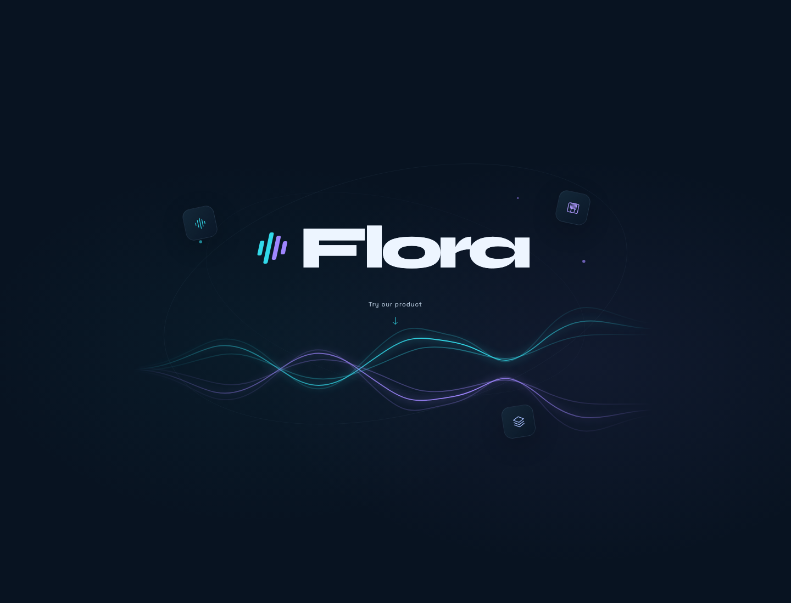
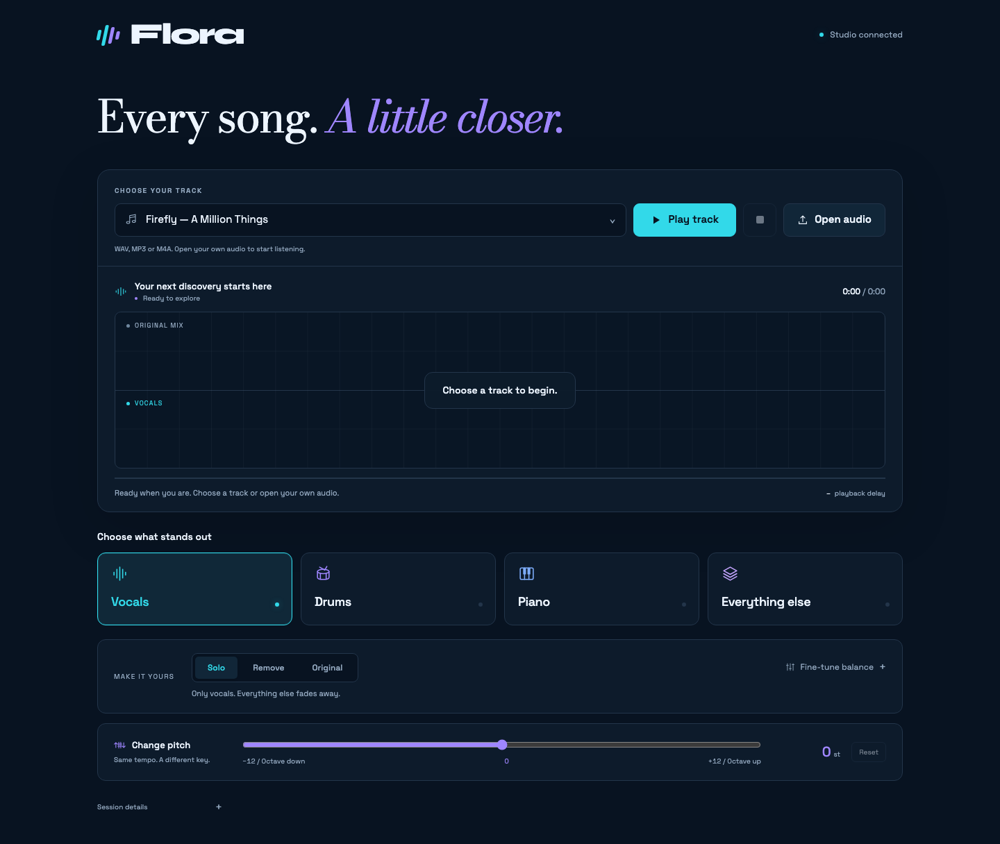

# Flora AI

**Explore every layer of your music.**

Flora is a browser-based instrument separation studio powered by a query-conditioned SCNet model. Stream a song, isolate an instrument or remove it from the mix, and transpose playback without changing its tempo.



## Features

- **Instrument separation:** vocals, drums, piano, and everything else.
- **Listening modes:** Solo, Remove, Original, and custom balance.
- **Live pitch control:** −12 to +12 semitones with a reset to original pitch.
- **Continuous playback:** WebSocket audio, overlapping windows, and smooth instrument switching.
- **Audio files and demo library:** open your own audio or configure local demo tracks.
- **Responsive studio:** desktop and mobile layouts, keyboard instrument shortcuts, and session diagnostics.



## How it works

```text
Audio file → Browser → WebSocket → Overlapping audio windows
                                         ↓
                               SCNet + instrument conditioning
                                         ↓
Browser playback ← Pitch processing ← Selected part + remaining mix
```

One model receives the mixture and an instrument query. FiLM conditioning guides the network toward that instrument. Predictions are blended with 50% overlap. A shared background worker batches requests while the server continues receiving and sending audio.

Pitch processing runs in the browser after separation and mixing. It changes the key of the audible output; it does not detect the song's key or convert between major and minor scales.

## Quick start

### 1. Install

Use Python 3.10 or newer. A GPU is recommended for training; inference can run on CPU.

```bash
git clone https://github.com/Ram-ui31/Flora-AI.git
cd Flora-AI
python3 -m venv .venv
source .venv/bin/activate
python -m pip install -r requirements.txt
```

On Windows, activate with `.venv\Scripts\activate`.

### 2. Supply a trained checkpoint

**Model weights and datasets are not included.** Place a compatible SCNet + FiLM checkpoint at `checkpoints/scnet2/best.pt`, or pass its actual location with `--ckpt`. The application cannot perform separation without a trained checkpoint. See [training](docs/TRAINING.md) to train your own.

Checkpoint files contain model parameters and training arguments. Load only checkpoints you trust.

### 3. Start the studio

```bash
python scripts/stream_server.py \
  --ckpt checkpoints/scnet2/best.pt \
  --device cpu --threads 16 \
  --window 2 --host 127.0.0.1 --port 8765 \
  --instruments vocals,drums,piano,other
```

Open **http://localhost:8765**, select **Try our product**, then **Open audio**. Use `--window 1` for a shorter buffering delay. Set `--threads` to suit your CPU; the reported load results used 16 threads.

The demo catalog starts empty. To add your own tracks, follow [demo setup](demo/README.md). Audio files are ignored by Git.

Pitch control requires AudioWorklet support in a modern browser over localhost or HTTPS. At extreme shifts, the sound may become more processed. The UI uses Google Fonts with system-font fallbacks.

## Results

Recorded results for the final `scnet2` checkpoint on held-out full songs. Median SDR in dB; higher is better.

| Test set | Vocals | Drums | Piano | Guitar | Other* |
| --- | ---: | ---: | ---: | ---: | ---: |
| MoisesDB, 28 songs | 9.7 | 9.3 | 3.5 | 4.4 | 7.8 |
| MUSDB18-HQ, 50 songs | 7.8 | 7.6 | — | — | — |

*Evaluation “other” is the residual after vocals, drums, **guitar**, and piano. In the default four-choice UI, “everything else” retains guitar because it subtracts only vocals, drums, and piano. Scores use songs where each target is present; not every instrument appears in every song. A dash means no reported result.

| Window | Approximate single-listener delay | Listeners sustained on the tested CPU |
| --- | ---: | ---: |
| 2 seconds | 2.2 seconds | 2 |
| 1 second | 1.1 seconds | 4 |

These are project measurements, not universal hardware guarantees. No pieces were lost in the recorded 30-second load tests. Browser pitch processing was added later and is not included in those benchmark figures. Full records are in [`eval/`](eval/).

## Limitations

- Guitar and piano can leak into one another when playing similar parts. The default UI groups guitar under “everything else.”
- Streaming keeps pace after a buffering delay; it is not zero-latency live monitoring.
- Shorter windows reduce delay but provide less musical context.
- The current streaming server does not flush a final partial window on disconnect/end-of-file. Use offline separation when complete-file output is required.
- This is a research prototype; large-scale deployment, authentication, and prolonged load testing are outside the current implementation.

## Offline separation

```bash
python scripts/separate.py \
  --ckpt checkpoints/scnet2/best.pt \
  --input song.wav --out separated/
```

The CLI expects 44.1 kHz audio. It writes vocals, drums, guitar, piano, and the residual. Use `--target vocals` to write one instrument and its residual instead.

## Development

```bash
python -m pip install -r requirements-dev.txt
python -m pytest -q
```

Tests cover the mixer, overlap-add reconstruction, instrument switching, async batching, and SCNet checkpoint loading. GitHub Actions runs the Python tests. Tests use small randomly initialized models and synthetic audio; no datasets or trained weights are needed.

## Repository layout

```text
web/                 Flora homepage, studio, and bundled pitch processor
sep/                 SCNet model, data mixer, losses, inference, streaming engine
scripts/             Dataset indexing, server, separation, evaluation, benchmarks
train.py             SCNet training and fine-tuning
tests/              Automated tests
demo/               Empty demo catalog, example, and setup instructions
eval/               Final model evaluation and load-test records
docs/               Architecture, training guide, screenshots
licenses/           Third-party license notices
remote/demo.sh      Optional helper for an existing SSH-hosted demo
```

See [architecture](docs/ARCHITECTURE.md), [training](docs/TRAINING.md), and [contributing](CONTRIBUTING.md).

## Credits

Created by **Ram Upadhyay** for the CSESA Project Series, Autumn 2026.

The separator adapts [SCNet](https://github.com/starrytong/SCNet) with query conditioning. Browser pitch processing uses [SoundTouchJS](https://github.com/cutterbl/SoundTouchJS). See [third-party notices](THIRD_PARTY_NOTICES.md). No blanket project license is declared; third-party components retain their own licenses.
